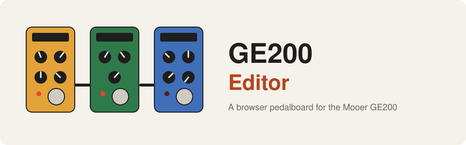
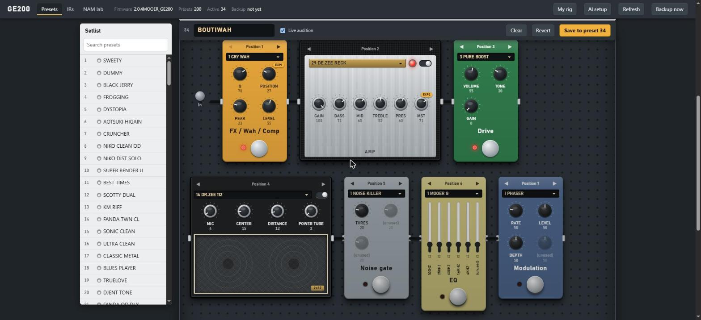

<div align="center">



**Mooer GE200용 브라우저 페달보드. USB로 200개 프리셋을 모두 편집하고, AI에게 톤을 설명하고, 나만의 캐비닛 IR을 올리고, 익스프레션 페달을 설정하세요.**

[](LICENSE)


[English](README.md) · [Türkçe](README.tr.md) · [简体中文](README.zh-CN.md) · [Русский](README.ru.md) · **한국어**

</div>

---

<p align="center"></p>

## 이게 뭔가요?

GE200은 프리셋 200개를 담은 소형 기타 멀티 이펙터입니다. 이 프로젝트는 **USB로 장치와 직접** 통신하고(프로토콜은 제조사 편집기의 정적 분석과
USB 캡처로 알아냈으며 제조사 파일은 포함되어 있지 않습니다) 장치 전체를 페달보드처럼 그려 브라우저에 띄웁니다.

- **페달보드 편집기.** 아홉 개 모듈이 신호 체인 순서대로 스톰프박스, 앰프 헤드, 스피커 캐비닛으로 놓입니다. 노브에는 선택한 모델에 대해
  장치가 쓰는 이름이 표시됩니다. **Live audition**은 작업용 사본만 바꾸고, **Save**는 슬롯에 쓰기 전에 백업하고 다시 읽어 확인합니다.
- **톤 생성기.** 톤을 설명해 보세요("길고 반짝이는 리버브가 있는 몽환적인 클린"). Claude, OpenAI, Gemini, OpenRouter 또는 내 컴퓨터의 모델이
  프리셋을 제안하며, 결과는 내 프리셋이 쓰는 범위로 제한되고 Save를 누르기 전에는 저장되지 않습니다.
- **나만의 캐비닛 IR.** WAV 파일을 놓으면 전송될 내용(512 샘플)을 보여 주고, 이름을 붙여 IR 슬롯 10개 중 하나에 넣습니다.
- **익스프레션 페달.** EXP와 EXP2를 어떤 모듈의 어떤 노브에든 할당할 수 있고, **MERGE**(페달 하나가 여러 노브를 동시에, 각각 힐 값에서 토 값까지 움직임)도 지원합니다.
- **NAM 랩.** DI 녹음을 Neural Amp Modeler 캡처와 캐비닛 IR에 통과시켜 오프라인으로 들어 봅니다.
- **CLI와 Python 라이브러리.** 스크립트에서 프리셋을 덤프, 비교, 선택, 저장합니다.

## 동작 방식

```
 브라우저 편집기 (localhost) --> Python 서버 --> USB HID --> GE200

 AI 제공자 (선택) --> 프리셋 제안 --> 내 범위로 제한 --> 편집기 --> 내가 Save를 누름
```

## 빠른 시작

> Windows 10/11, USB로 연결된 GE200, Python 3.9 이상.

```powershell
git clone https://github.com/atahan26/ge200-editor
cd ge200-editor
py -3 -m venv .venv
.venv\Scripts\python.exe -m pip install -e ".[audio,llm]"
.venv\Scripts\python.exe -m ge200 devices                                # 장치를 찾음, 아무것도 보내지 않음
.venv\Scripts\python.exe -m ge200 dump backup.json --raw backup.bin      # 먼저 200개 프리셋을 백업
.venv\Scripts\python.exe -m ge200.web --backup-dir backups
```

http://127.0.0.1:8200/ 을 여세요. 장치 전체를 읽는 데 약 16초가 걸립니다(초당 프리셋 12개를 내보냅니다). 왼쪽에서 프리셋을 고르세요.
상단의 **AI setup**에서 톤 생성기 제공자를 연결합니다. 장치가 없다면 저장해 둔 덤프로 편집기를 체험해 보세요:
`python -m ge200.web --backup-dir backups --demo-raw backup.bin`.

## 중요: 이 프로그램은 장치에 씁니다

- 프리셋 선택과 **Live audition**은 안전합니다: 작업용 사본만 건드립니다.
- **Save**는 200개 프리셋 슬롯 중 하나를 덮어씁니다. 먼저 전체 JSON 백업이 만들어지고(세션당 한 번) 슬롯을 다시 읽어 확인합니다.
- **IR을 올리면 IR 슬롯 10개 중 하나가 바뀌며, 장치는 이전 IR을 돌려주지 못합니다.**
- 여기에는 **펌웨어를 쓰는 코드가 없습니다**. 이 프로그램이 열려 있는 동안 제조사 업데이트 프로그램을 실행하지 마세요.
- 장치는 한 번에 프로그램 하나만 쓸 수 있습니다: 먼저 제조사 편집기를 닫으세요.
- 펌웨어 2.0.4의 GE200 한 대에서만 테스트했습니다. 덤프에는 내 프리셋이 들어 있으니 공개 저장소에 올리지 마세요.

## 무엇이 검증되었나

| 영역 | 상태 |
|---|---|
| USB 프로토콜, 프리셋 구조, 다시 읽기를 포함한 Save | 실제 장치에서 검증됨 |
| 모델별 노브 이름 | 펌웨어에서 가져와 실제 프리셋 200개와 교차 확인 |
| IR 업로드 | 검증됨: 장치가 받아들이고 이름을 표시하며 기대한 대로 들림 |
| 익스프레션 페달과 MERGE | 장치의 상태 프레임과 펌웨어 자체의 MERGE 코드에서 해독했고 프리셋 200개로 확인(대상 115개 중 114개가 해당 모델에 존재). 아직 페달을 움직여 시험하지 않음 |
| 톤 생성기 | Claude는 실제 API로 시험, 다른 제공자는 로컬 가짜 서버로 시험 |
| Raspberry Pi / Linux 전송 | 작성됨, 가짜 I/O로만 시험 |
| 실시간 NAM | Python에서는 현실적이지 않음(측정함). NAM 랩은 오프라인 |

자세한 내용과 남은 질문은 [PROTOCOL.md](PROTOCOL.md), 모든 기능은 [docs/USAGE.md](docs/USAGE.md)에 있습니다.

## 프로젝트 구조

| 경로 | 용도 |
|------|---------|
| `ge200/protocol.py`, `client.py`, `hid_win.py`, `hid_linux.py` | USB HID 프로토콜 클라이언트(읽기, 선택, 저장, IR 업로드) |
| `ge200/preset.py`, `params.py` | 512바이트 프리셋 구조, 익스프레션 페달과 MERGE, 모델별 노브 이름 |
| `ge200/web/` | 편집기: 로컬 서버와 단일 페이지 페달보드 UI |
| `ge200/llm.py`, `tone.py`, `rig.py` | AI 제공자, 톤 생성기, 내 기타와 취향 프로필 |
| `ge200/ir.py`, `ge200/nam/` | IR 변환, 오프라인 NAM 렌더링 |
| `tools/` | 일회성 실험(일부는 장치에 씁니다: 각 파일의 설명을 먼저 읽으세요) |
| `PROTOCOL.md` | 검증된 것과 추측에 불과한 것 |
| `AGENTS.md` | AI 코딩 에이전트를 위한 안내 |

## AI 에이전트와 함께 쓰기

복제한 저장소에서 연 Claude Code, Codex, Cursor 등의 코딩 에이전트에 아래 블록을 붙여 넣으세요:

```text
먼저 이 저장소의 AGENTS.md, README.md, PROTOCOL.md를 읽어라. 이것은 USB로 Mooer GE200을 다루는 비공식 도구 모음이다.
다음을 도와줘: <원하는 작업, 예: "새 LLM 제공자 추가" 또는 "페달 보정 해독">. AGENTS.md의 안전 규칙을 따를 것.
내게 묻지 않고 연결된 장치에 쓰거나, 무언가를 플래시하거나, 덤프를 커밋하지 마라.
```

## 이 프로젝트에 대해

개인 프로젝트입니다. 저자가 목표를 정하고, 모든 단계를 실제 GE200에서 직접 시험하며, 무엇을 남길지 결정했습니다. 프로토콜 분석과
코드 대부분은 [Claude Code](https://claude.com/claude-code)가 작성했습니다. 다시 만들 수 없는 프리셋을 맡기기 전에 코드를 검토하세요. dump 명령이 그래서 있습니다.

## 라이선스

[MIT](LICENSE). Mooer와 제휴, 승인, 후원 관계가 없습니다. 모든 제품 이름은 각 소유자의 것입니다. 기여와 이슈를 환영합니다.

<sub>키워드: Mooer GE200, 멀티 이펙터, 기타 페달, 프리셋 편집기, USB HID, 리버스 엔지니어링, 익스프레션 페달, 임펄스 응답, 캐비닛 IR, Neural Amp Modeler, NAM, Windows, Python</sub>
