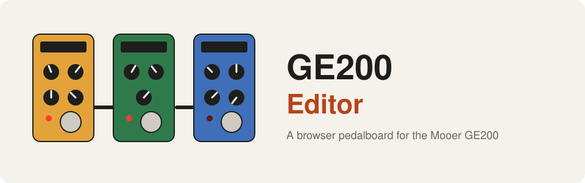
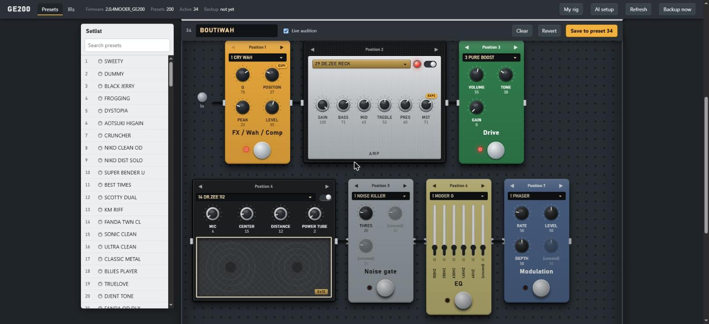

<div align="center">



**A browser pedalboard for the Mooer GE200. Edit all 200 presets over USB, describe a tone to an AI, load your own cabinet IRs and set the expression pedal.**

[](LICENSE)


**English** · [Türkçe](README.tr.md) · [简体中文](README.zh-CN.md) · [Русский](README.ru.md) · [한국어](README.ko.md)

</div>

---

<p align="center"></p>

## What is this?

The GE200 is a compact guitar multi-effects unit with 200 presets. This project talks to it **directly over USB** (the
protocol was worked out by static analysis of the vendor editor and USB captures; no vendor files are included) and puts
the whole unit in your browser, drawn like a pedalboard.

- **Pedalboard editor.** The nine modules sit in signal-chain order as stompboxes, an amp head and a speaker cabinet.
  Knobs carry the unit's own names for the selected model. **Live audition** changes the working copy only; **Save**
  writes the slot, backs up first and reads it back.
- **Tone generator.** Describe a tone ("dreamy clean with a long shimmery reverb"). Claude, OpenAI, Gemini, OpenRouter or a
  model on your own machine proposes a preset; it is clamped to the ranges your own presets use and stored only when you press Save.
- **Your own cabinet IRs.** Drop a WAV, see what will be sent (512 samples), name it and put it in one of the 10 IR slots.
- **Expression pedals.** Assign EXP and EXP2 to any knob of any module, including **MERGE** (one pedal moving several knobs, each from
  its heel to its toe value).
- **CLI and Python library.** Dump, diff, select and store presets from scripts.

## How it works

```
 Browser editor (localhost) --> Python server --> USB HID --> GE200

 AI provider (optional) --> proposes a preset --> clamped to your own ranges --> editor --> you press Save
```

## Quick start

> Windows 10/11, a GE200 connected over USB, Python 3.9 or newer.

```powershell
git clone https://github.com/atahan26/ge200-editor
cd ge200-editor
py -3 -m venv .venv
.venv\Scripts\python.exe -m pip install -e ".[audio,llm]"
.venv\Scripts\python.exe -m ge200 devices                                # finds the unit, no I/O
.venv\Scripts\python.exe -m ge200 dump backup.json --raw backup.bin      # back up all 200 presets first
.venv\Scripts\python.exe -m ge200.web --backup-dir backups
```

Open http://127.0.0.1:8200/. Reading the whole unit takes about 16 seconds (it streams 12 presets per second). Pick a
preset on the left; **AI setup** in the top bar connects a tone-generator provider. No unit at hand? Try the editor on a saved
dump: `python -m ge200.web --backup-dir backups --demo-raw backup.bin`.

## Important: this writes to your unit

- Selecting a preset and **Live audition** are harmless: they touch the working copy only.
- **Save** overwrites one of the 200 preset slots. A full JSON backup is written first (once per session) and the slot is read back to verify.
- **Uploading an IR replaces one of the 10 IR slots, and the unit cannot give the old one back.**
- There is **no firmware-flashing code** here. Do not run the vendor updater while this program is open.
- Only one program can use the unit at a time: close the vendor editor first.
- Tested on one GE200 with firmware 2.0.4. Dumps contain your own presets: keep them out of public repositories.

## What is verified

| Area | State |
|---|---|
| USB protocol, preset layout, Save with read-back | Verified on a real unit |
| Knob names per model | Taken from the firmware and cross-checked against 200 real presets |
| IR upload | Verified: the unit accepts it and shows the name; it sounds as expected |
| Expression pedal and MERGE | Decoded from the unit's state frames and the firmware's own MERGE code, checked on 200 presets (114 of 115 targets exist on the model). Not yet tested by moving the pedal |
| Tone generator | Claude tested against the real API; the other providers against a local fake server |
| Raspberry Pi / Linux transport | Written, tested with fake I/O only |

Details and the open questions are in [PROTOCOL.md](PROTOCOL.md); every feature is described in [docs/USAGE.md](docs/USAGE.md).

## Project layout

| Path | Purpose |
|------|---------|
| `ge200/protocol.py`, `client.py`, `hid_win.py`, `hid_linux.py` | USB HID protocol client (read, select, store, IR upload) |
| `ge200/preset.py`, `params.py` | The 512-byte preset layout, expression pedal and MERGE, knob names per model |
| `ge200/web/` | The editor: local server and the single-page pedalboard UI |
| `ge200/llm.py`, `tone.py`, `rig.py` | AI providers, the tone generator, your guitar and taste profile |
| `ge200/ir.py` | IR conversion to the unit's 512-sample format |
| `tools/` | One-off experiments (several write to the unit: read each docstring first) |
| `PROTOCOL.md` | What is verified and what is only inferred |
| `AGENTS.md` | Instructions for AI coding agents |

## Use it with an AI agent

Copy this block into Claude Code, Codex, Cursor or any coding agent opened in your clone:

```text
Read AGENTS.md, README.md and PROTOCOL.md in this repository first. This is an unofficial toolkit for the
Mooer GE200 over USB. Help me with: <what you want, for example "add a new LLM provider" or "decode the
pedal calibration">. Follow the safety rules in AGENTS.md. Do not write to a connected unit, flash anything
or commit dumps without asking me first.
```

## About this project

A personal project. The author set the goals, owned and tested every step on a real GE200 and decided what to keep.
The protocol analysis and the code were written mostly by [Claude Code](https://claude.com/claude-code). Review it
before trusting it with presets you cannot recreate; the dump command exists for that reason.

## License

[MIT](LICENSE). Not affiliated with, endorsed by or sponsored by Mooer. All product names belong to their owners.
Contributions and issues are welcome.

<sub>Keywords: Mooer GE200, multi-effects, guitar pedal, preset editor, USB HID, reverse engineering, expression pedal, impulse response, cabinet IR, Windows, Python</sub>
