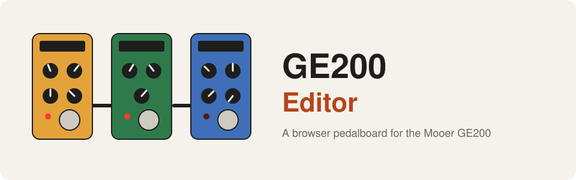
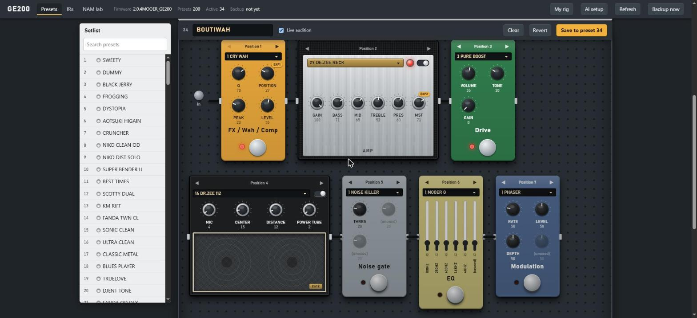

<div align="center">



**Педалборд в браузере для Mooer GE200. Редактируйте все 200 пресетов по USB, описывайте звук нейросети, загружайте собственные кабинетные IR и настраивайте педаль экспрессии.**

[](LICENSE)


[English](README.md) · [Türkçe](README.tr.md) · [简体中文](README.zh-CN.md) · **Русский** · [한국어](README.ko.md)

</div>

---

<p align="center"></p>

## Что это?

GE200 — компактный гитарный процессор эффектов на 200 пресетов. Этот проект общается с ним **напрямую по USB** (протокол
выяснен статическим анализом редактора производителя и перехватом USB; файлов производителя здесь нет) и показывает
весь аппарат в браузере в виде педалборда.

- **Редактор-педалборд.** Девять модулей стоят в порядке сигнальной цепи: педали, голова усилителя и кабинет. На ручках
  подписи, которые сам аппарат использует для выбранной модели. **Live audition** меняет только рабочую копию;
  **Save** записывает слот, сначала делает резервную копию и читает обратно для проверки.
- **Генератор тона.** Опишите звук («мечтательный чистый звук с долгой переливающейся реверберацией»). Claude, OpenAI, Gemini,
  OpenRouter или модель на вашем компьютере предложит пресет; значения ограничиваются диапазонами ваших же пресетов и
  сохраняются только после нажатия Save.
- **Собственные кабинетные IR.** Перетащите WAV, посмотрите, что будет отправлено (512 отсчётов), назовите и положите в один из 10 слотов IR.
- **Педали экспрессии.** Назначьте EXP и EXP2 на любую ручку любого модуля, включая **MERGE** (одна педаль двигает сразу
  несколько ручек, каждую от значения «пятка» до значения «носок»).
- **NAM lab.** Пропустите DI-запись через снимок Neural Amp Modeler и кабинетный IR и послушайте результат офлайн.
- **CLI и библиотека Python.** Выгружайте, сравнивайте, выбирайте и сохраняйте пресеты из скриптов.

## Как это работает

```
 Редактор в браузере (localhost) --> сервер Python --> USB HID --> GE200

 Поставщик ИИ (необязательно) --> предлагает пресет --> ограничивается вашими диапазонами --> редактор --> вы нажимаете Save
```

## Быстрый старт

> Windows 10/11, GE200, подключённый по USB, Python 3.9 или новее.

```powershell
git clone https://github.com/atahan26/ge200-editor
cd ge200-editor
py -3 -m venv .venv
.venv\Scripts\python.exe -m pip install -e ".[audio,llm]"
.venv\Scripts\python.exe -m ge200 devices                                # находит аппарат, ничего не отправляет
.venv\Scripts\python.exe -m ge200 dump backup.json --raw backup.bin      # сначала сделайте копию всех 200 пресетов
.venv\Scripts\python.exe -m ge200.web --backup-dir backups
```

Откройте http://127.0.0.1:8200/. Чтение всего аппарата занимает около 16 секунд (он передаёт 12 пресетов в секунду). Выберите
пресет слева; **AI setup** в верхней панели подключает поставщика для генератора тона. Нет аппарата под рукой? Попробуйте редактор
на сохранённом дампе: `python -m ge200.web --backup-dir backups --demo-raw backup.bin`.

## Важно: программа пишет в ваш аппарат

- Выбор пресета и **Live audition** безвредны: затрагивается только рабочая копия.
- **Save** перезаписывает один из 200 слотов пресетов. Сначала записывается полная JSON-копия (раз за сеанс), затем слот читается обратно для проверки.
- **Загрузка IR заменяет один из 10 слотов IR, и аппарат не вернёт старый.**
- Здесь **нет кода для прошивки**. Не запускайте программу обновления производителя, пока эта программа открыта.
- С аппаратом одновременно может работать только одна программа: сначала закройте редактор производителя.
- Проверено на одном GE200 с прошивкой 2.0.4. Дампы содержат ваши пресеты: не кладите их в публичные репозитории.

## Что проверено

| Область | Состояние |
|---|---|
| Протокол USB, структура пресета, Save с чтением обратно | Проверено на реальном аппарате |
| Названия ручек для каждой модели | Взяты из прошивки и сверены с 200 реальными пресетами |
| Загрузка IR | Проверено: аппарат принимает файл и показывает имя; звучит как ожидалось |
| Педаль экспрессии и MERGE | Расшифровано по кадрам состояния аппарата и по собственному коду MERGE в прошивке, проверено на 200 пресетах (114 из 115 целей существуют на модели). Ещё не проверено движением педали |
| Генератор тона | Claude проверен на настоящем API; остальные поставщики — на локальном поддельном сервере |
| Транспорт Raspberry Pi / Linux | Написан, проверен только на поддельном вводе-выводе |
| NAM вживую | Непрактично на Python (измерено). NAM lab работает офлайн |

Подробности и открытые вопросы — в [PROTOCOL.md](PROTOCOL.md); все возможности описаны в [docs/USAGE.md](docs/USAGE.md).

## Структура проекта

| Путь | Назначение |
|------|---------|
| `ge200/protocol.py`, `client.py`, `hid_win.py`, `hid_linux.py` | Клиент протокола USB HID (чтение, выбор, сохранение, загрузка IR) |
| `ge200/preset.py`, `params.py` | 512-байтовая структура пресета, педаль экспрессии и MERGE, названия ручек по моделям |
| `ge200/web/` | Редактор: локальный сервер и одностраничный интерфейс педалборда |
| `ge200/llm.py`, `tone.py`, `rig.py` | Поставщики ИИ, генератор тона, профиль вашей гитары и вкуса |
| `ge200/ir.py`, `ge200/nam/` | Преобразование IR, офлайн-рендеринг NAM |
| `tools/` | Разовые эксперименты (некоторые пишут в аппарат: сначала прочитайте описание файла) |
| `PROTOCOL.md` | Что проверено и что лишь предположено |
| `AGENTS.md` | Инструкции для ИИ-агентов, пишущих код |

## Использование с ИИ-агентом

Скопируйте этот блок в Claude Code, Codex, Cursor или другого агента, открытого в вашем клоне:

```text
Сначала прочитай AGENTS.md, README.md и PROTOCOL.md в этом репозитории. Это неофициальный набор инструментов для
Mooer GE200 по USB. Помоги мне с: <что нужно, например «добавить нового поставщика LLM» или «расшифровать
калибровку педали»>. Соблюдай правила безопасности из AGENTS.md. Не пиши в подключённый аппарат, ничего не
прошивай и не коммить дампы, не спросив меня.
```

## О проекте

Личный проект. Автор поставил цели, сам проверил каждый шаг на реальном GE200 и решил, что оставить. Анализ протокола и
большая часть кода написаны [Claude Code](https://claude.com/claude-code). Просмотрите код, прежде чем доверять ему пресеты,
которые нельзя восстановить; команда dump существует именно для этого.

## Лицензия

[MIT](LICENSE). Не связан с Mooer, не одобрен и не спонсирован им. Все названия продуктов принадлежат их владельцам.
Вклад и issue приветствуются.

<sub>Ключевые слова: Mooer GE200, процессор эффектов, гитарная педаль, редактор пресетов, USB HID, реверс-инжиниринг, педаль экспрессии, импульсная характеристика, кабинетный IR, Neural Amp Modeler, NAM, Windows, Python</sub>
