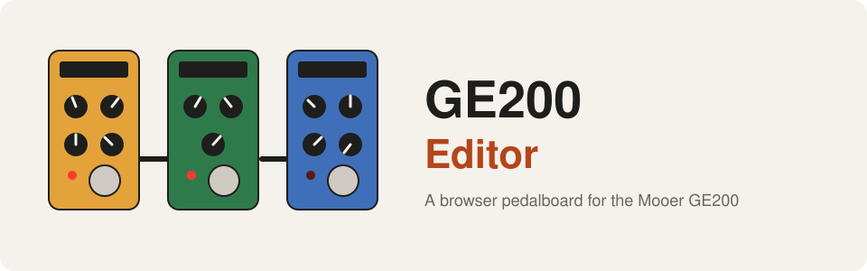
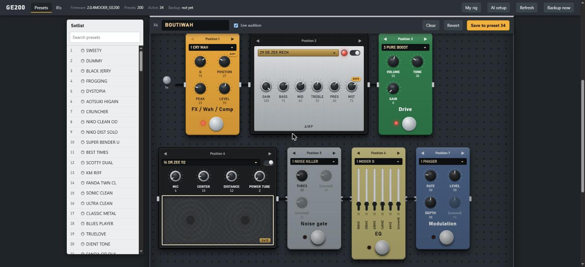
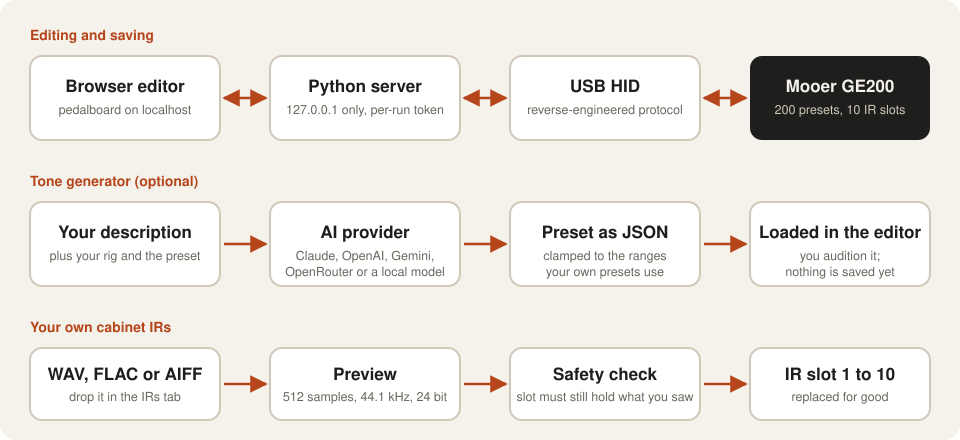
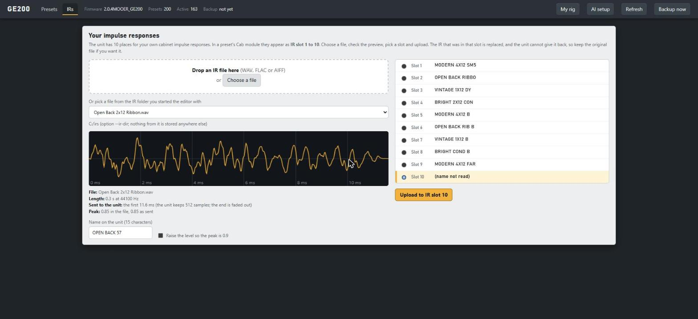
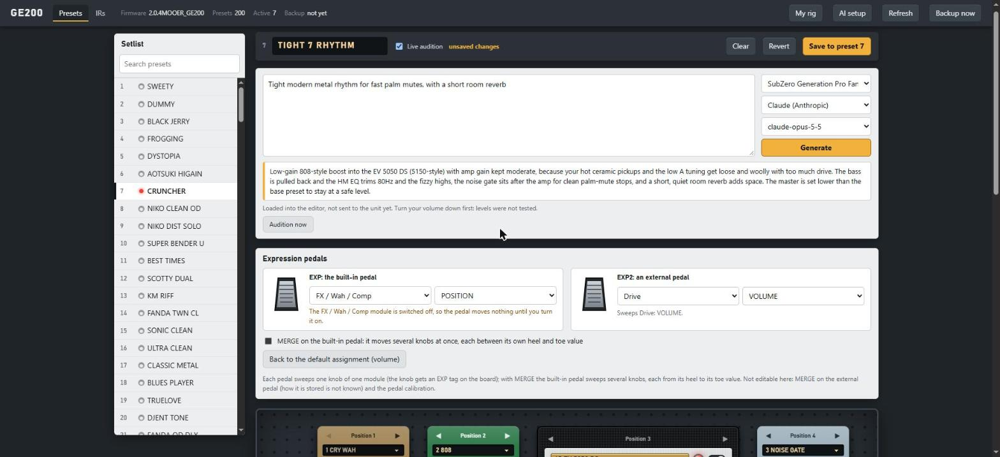
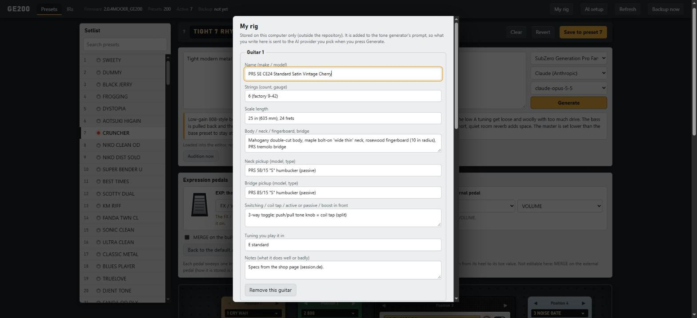

<div align="center">



**Mooer GE200 için tarayıcıda bir pedalboard. USB üzerinden 200 preset'in tamamını düzenle, bir yapay zekaya ton tarif et, kendi kabin IR'larını yükle ve expression pedalını ayarla.**

[](LICENSE)


[English](README.md) · **Türkçe** · [简体中文](README.zh-CN.md) · [Русский](README.ru.md) · [한국어](README.ko.md)

</div>

---

<p align="center"></p>

## Bu nedir?

GE200, 200 preset'i olan kompakt bir gitar multi-efekt cihazı. Bu proje cihazla **doğrudan USB üzerinden** konuşur
(protokol, satıcının editör programının statik analizi ve USB kayıtlarıyla çözüldü; satıcıya ait hiçbir dosya dahil değil)
ve cihazın tamamını tarayıcında, bir pedalboard gibi çizilmiş halde sunar.

- **Pedalboard editörü.** Dokuz modül sinyal zinciri sırasıyla stompbox, amfi başlığı ve hoparlör kabini olarak durur.
  Düğmelerde seçili modelin cihazdaki kendi adları yazar. **Live audition** yalnızca çalışma kopyasını değiştirir;
  **Save** slota yazar, önce yedek alır ve geri okuyarak doğrular.
- **Ton üretici.** Bir ton tarif et ("uzun, parıltılı reverb'li hayalperest clean"). Claude, OpenAI, Gemini, OpenRouter veya
  kendi bilgisayarındaki bir model preset önerir; öneri kendi preset'lerinin aralıklarına sıkıştırılır ve sen Save'e basana kadar saklanmaz.
- **Kendi kabin IR'ların.** Bir WAV bırak, gönderilecek hali (512 örnek) gör, adını ver ve 10 IR slotundan birine koy.
- **Expression pedalları.** EXP ve EXP2'yi herhangi bir modülün herhangi bir düğmesine ata. **MERGE** de var (tek pedalın
  birkaç düğmeyi birlikte sürmesi, her biri topuk değerinden uç değerine).
- **CLI ve Python kütüphanesi.** Preset'leri betiklerden dök, karşılaştır, seç ve sakla.

## Nasıl çalışır?

<p align="center"></p>

## Diğer ekranlar

<p align="center"><br><sub>Kendi IR'ların: dosyayı bırak, gönderilecek hali tam olarak gör, adını ver ve 10 slottan birini seç.</sub></p>

<p align="center"><br><sub>Ton üretici: bir ton tarif et, gitarı ve sağlayıcıyı seç. Cevap editöre yüklenir, saklanmaz.</sub></p>

<p align="center"><br><sub>My rig: gitarların, manyetiklerin, akortların ve zevkin bilgisayarında kalır ve ton üreticinin istemine eklenir.</sub></p>

## Hızlı başlangıç

> Windows 10/11, USB ile bağlı bir GE200, Python 3.9 veya üstü.

```powershell
git clone https://github.com/atahan26/ge200-editor
cd ge200-editor
py -3 -m venv .venv
.venv\Scripts\python.exe -m pip install -e ".[audio,llm]"
.venv\Scripts\python.exe -m ge200 devices                                # cihazı bulur, hiçbir şey göndermez
.venv\Scripts\python.exe -m ge200 dump backup.json --raw backup.bin      # önce 200 preset'in yedeğini al
.venv\Scripts\python.exe -m ge200.web --backup-dir backups
```

http://127.0.0.1:8200/ adresini aç. Cihazın tamamını okumak yaklaşık 16 saniye sürer (saniyede 12 preset akıtır). Soldan bir
preset seç; üst çubuktaki **AI setup** bir ton üretici sağlayıcısı bağlar. Elinde cihaz yok mu? Editörü kayıtlı bir dökümle dene:
`python -m ge200.web --backup-dir backups --demo-raw backup.bin`.

## Önemli: bu cihazına yazar

- Preset seçmek ve **Live audition** zararsızdır: yalnızca çalışma kopyasına dokunur.
- **Save**, 200 preset slotundan birinin üzerine yazar. Önce tam bir JSON yedeği alınır (oturum başına bir kez) ve slot geri okunup doğrulanır.
- **Bir IR yüklemek 10 IR slotundan birini değiştirir ve cihaz eskisini geri veremez.**
- Burada **firmware yazma kodu yok**. Bu program açıkken satıcının güncelleme programını çalıştırma.
- Cihazı aynı anda tek program kullanabilir: önce satıcının editörünü kapat.
- Firmware 2.0.4 olan tek bir GE200 üzerinde denendi. Dökümler kendi preset'lerini içerir: herkese açık repolardan uzak tut.

## Neler doğrulandı?

| Alan | Durum |
|---|---|
| USB protokolü, preset düzeni, geri okumalı Save | Gerçek cihazda doğrulandı |
| Modele göre düğme adları | Firmware'den alındı, 200 gerçek preset ile çapraz kontrol edildi |
| IR yükleme | Doğrulandı: cihaz kabul ediyor ve adı gösteriyor; beklendiği gibi duyuluyor |
| Expression pedal ve MERGE | Cihazın durum çerçevelerinden ve firmware'in kendi MERGE kodundan çözüldü, 200 preset üzerinde kontrol edildi (115 hedefin 114'ü o modelde gerçekten var). Pedal oynatılarak henüz denenmedi |
| Ton üretici | Claude gerçek API ile denendi; diğer sağlayıcılar yerel sahte sunucuyla |
| Raspberry Pi / Linux aktarımı | Yazıldı, yalnızca sahte G/Ç ile test edildi |

Ayrıntılar ve açık sorular [PROTOCOL.md](PROTOCOL.md) içinde; her özellik [docs/USAGE.md](docs/USAGE.md) içinde anlatılıyor.

## Proje yapısı

| Yol | Amaç |
|------|---------|
| `ge200/protocol.py`, `client.py`, `hid_win.py`, `hid_linux.py` | USB HID protokol istemcisi (oku, seç, sakla, IR yükle) |
| `ge200/preset.py`, `params.py` | 512 baytlık preset düzeni, expression pedal ve MERGE, modele göre düğme adları |
| `ge200/web/` | Editör: yerel sunucu ve tek sayfalık pedalboard arayüzü |
| `ge200/llm.py`, `tone.py`, `rig.py` | Yapay zeka sağlayıcıları, ton üretici, gitarın ve zevkinin profili |
| `ge200/ir.py` | IR'ı cihazın 512 örneklik biçimine dönüştürme |
| `tools/` | Tek seferlik denemeler (birkaçı cihaza yazar: önce her dosyanın açıklamasını oku) |
| `PROTOCOL.md` | Neyin doğrulandığı, neyin sadece tahmin olduğu |
| `AGENTS.md` | Yapay zeka kod ajanları için talimatlar |

## Yol haritası

- **Sahne için taşınabilir NAM düzeneği (plan, devam eden çalışma).** Yazar, GE200'ün yanında bir Raspberry Pi 5 ve bir Focusrite Scarlett Solo (3. nesil) ile Neural Amp Modeler'ı sahnede denemeyi planlıyor. **Bu yalnızca bir plan: henüz hiçbir şey yapılmadı veya denenmedi ve bu repoda bunun için kod yok.** Notlar ve açık sorular: [docs/ROADMAP.md](docs/ROADMAP.md).

## Bir yapay zeka ajanıyla kullan

Bu bloğu klonunda açık olan Claude Code, Codex, Cursor veya başka bir kod ajanına yapıştır:

```text
Önce bu repodaki AGENTS.md, README.md ve PROTOCOL.md dosyalarını oku. Bu, USB üzerinden Mooer GE200 için
resmi olmayan bir araç seti. Şu konuda yardım et: <ne istediğin, örneğin "yeni bir LLM sağlayıcısı ekle" veya
"pedal kalibrasyonunu çöz">. AGENTS.md'deki güvenlik kurallarına uy. Bana sormadan bağlı cihaza yazma,
bir şey flash'lama veya döküm commit'leme.
```

## Bu proje hakkında

Kişisel bir proje. Yazar hedefleri koydu, her adımı gerçek bir GE200 üzerinde denedi ve neyin kalacağına karar verdi.
Protokol analizi ve kodun çoğu [Claude Code](https://claude.com/claude-code) tarafından yazıldı. Yeniden yapamayacağın
preset'lere güvenmeden önce kodu gözden geçir; dump komutu bunun için var.

## Lisans

[MIT](LICENSE). Mooer ile bağlantılı değildir, onun tarafından onaylanmamış veya desteklenmemiştir. Tüm ürün adları sahiplerine aittir.
Katkılar ve issue'lar memnuniyetle karşılanır.

<sub>Anahtar kelimeler: Mooer GE200, multi-efekt, gitar pedalı, preset editörü, USB HID, tersine mühendislik, expression pedal, impulse response, kabin IR, Windows, Python</sub>
