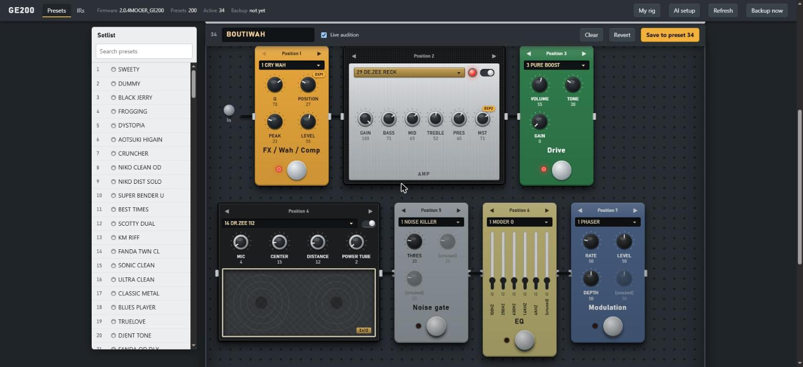
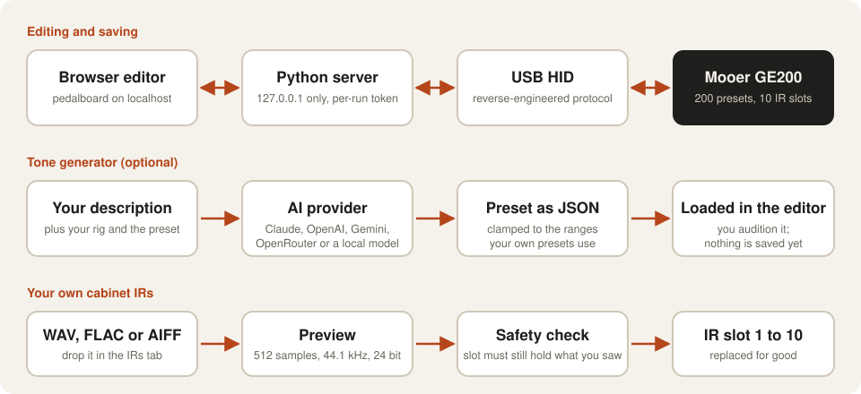
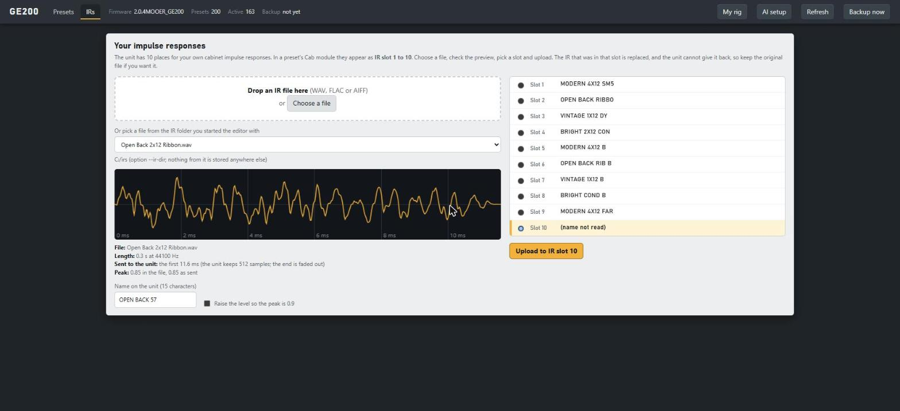
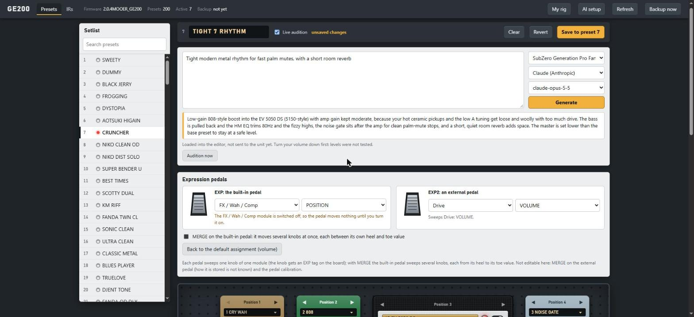
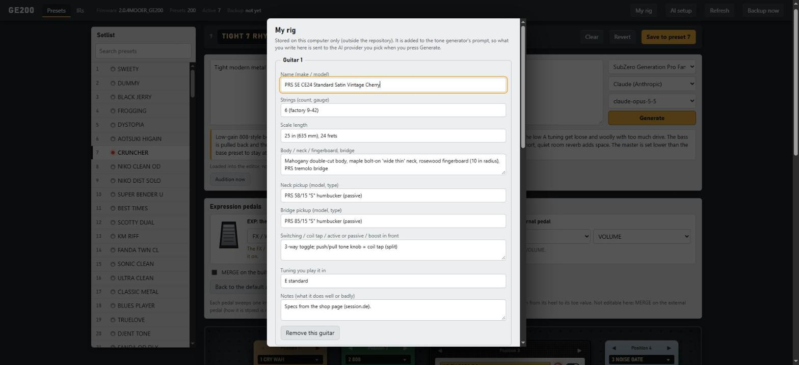

<div align="center">


**Mooer GE200 的浏览器效果器板。通过 USB 编辑全部 200 个预设，向 AI 描述音色，载入自己的箱体 IR，设置表情踏板。**

[](LICENSE)


[English](README.md) · [Türkçe](README.tr.md) · **简体中文** · [Русский](README.ru.md) · [한국어](README.ko.md)

</div>

---

<p align="center"></p>

## 这是什么？

GE200 是一台带 200 个预设的紧凑型吉他综合效果器。本项目**直接通过 USB** 与它通信（协议由对厂商编辑器的静态分析和
USB 抓包得出，不包含任何厂商文件），并把整台设备以效果器板的样子放进你的浏览器。

- **效果器板编辑器。** 九个模块按信号链顺序显示为单块效果器、音箱头和扬声器箱体。旋钮上写的是设备自己为所选型号
  定义的名称。**Live audition** 只改动工作副本；**Save** 写入槽位，先备份，再读回校验。
- **音色生成器。** 描述一个音色（“带悠长闪亮混响的梦幻清音”）。Claude、OpenAI、Gemini、OpenRouter 或你自己电脑上的模型
  会给出预设建议；结果会被限制在你自己预设所用的范围内，按下 Save 之前不会保存。
- **自己的箱体 IR。** 拖入一个 WAV，查看将要发送的内容（512 个采样），命名后放入 10 个 IR 槽位之一。
- **表情踏板。** 把 EXP 和 EXP2 分配给任何模块的任何旋钮，包括 **MERGE**（一个踏板同时驱动多个旋钮，每个旋钮从脚跟值走到脚尖值）。
- **命令行与 Python 库。** 用脚本导出、比较、选择和保存预设。

## 工作原理

<p align="center"></p>

## 更多界面

<p align="center"><br><sub>自己的 IR：拖入文件，准确查看将要发送的内容，命名并选择 10 个槽位之一。</sub></p>

<p align="center"><br><sub>音色生成器：描述音色，选择吉他和提供方。结果会载入编辑器，不会被保存。</sub></p>

<p align="center"><br><sub>My rig：你的吉他、拾音器、调弦和口味只保存在你的电脑上，并加入音色生成器的提示。</sub></p>

## 快速开始

> Windows 10/11，通过 USB 连接的 GE200，Python 3.9 或更高版本。

```powershell
git clone https://github.com/atahan26/ge200-editor
cd ge200-editor
py -3 -m venv .venv
.venv\Scripts\python.exe -m pip install -e ".[audio,llm]"
.venv\Scripts\python.exe -m ge200 devices                                # 查找设备，不发送任何数据
.venv\Scripts\python.exe -m ge200 dump backup.json --raw backup.bin      # 先备份全部 200 个预设
.venv\Scripts\python.exe -m ge200.web --backup-dir backups
```

打开 http://127.0.0.1:8200/。读取整台设备约需 16 秒（设备每秒传出 12 个预设）。在左侧选一个预设；顶部栏的
**AI setup** 用来连接音色生成器的提供方。手边没有设备？可以用保存的转储文件试用编辑器：
`python -m ge200.web --backup-dir backups --demo-raw backup.bin`。

## 重要：它会写入你的设备

- 选择预设和 **Live audition** 是无害的：只碰工作副本。
- **Save** 会覆盖 200 个预设槽位中的一个。会先写一份完整的 JSON 备份（每次会话一次），并读回该槽位进行校验。
- **上传 IR 会替换 10 个 IR 槽位中的一个，设备无法把旧的还给你。**
- 这里**没有写入固件的代码**。本程序运行时不要运行厂商的升级程序。
- 设备同一时间只能被一个程序使用：请先关闭厂商的编辑器。
- 只在一台固件为 2.0.4 的 GE200 上测试过。转储文件包含你自己的预设：不要放进公开仓库。

## 哪些已验证

| 方面 | 状态 |
|---|---|
| USB 协议、预设结构、带读回的 Save | 已在真实设备上验证 |
| 各型号的旋钮名称 | 取自固件，并用 200 个真实预设交叉检查 |
| IR 上传 | 已验证：设备接受并显示名称；听感符合预期 |
| 表情踏板与 MERGE | 由设备的状态帧和固件自身的 MERGE 代码解出，并在 200 个预设上检查（115 个目标中有 114 个确实存在于该型号）。尚未实际踩踏板测试 |
| 音色生成器 | Claude 已用真实 API 测试；其他提供方用本地模拟服务器测试 |
| Raspberry Pi / Linux 传输 | 已编写，仅用模拟 I/O 测试 |

详情和未解决的问题见 [PROTOCOL.md](PROTOCOL.md)；每个功能见 [docs/USAGE.md](docs/USAGE.md)。

## 项目结构

| 路径 | 用途 |
|------|---------|
| `ge200/protocol.py`, `client.py`, `hid_win.py`, `hid_linux.py` | USB HID 协议客户端（读取、选择、保存、上传 IR） |
| `ge200/preset.py`, `params.py` | 512 字节的预设结构、表情踏板与 MERGE、各型号的旋钮名称 |
| `ge200/web/` | 编辑器：本地服务器和单页效果器板界面 |
| `ge200/llm.py`, `tone.py`, `rig.py` | AI 提供方、音色生成器、你的吉他和口味档案 |
| `ge200/ir.py` | 把 IR 转换为设备的 512 采样格式 |
| `tools/` | 一次性实验（有几个会写入设备：先读每个文件的说明） |
| `PROTOCOL.md` | 哪些已验证，哪些只是推测 |
| `AGENTS.md` | 给 AI 编程代理的说明 |

## 与 AI 代理一起使用

把下面这段复制到在你的克隆目录中打开的 Claude Code、Codex、Cursor 或其他编程代理里：

```text
先阅读本仓库的 AGENTS.md、README.md 和 PROTOCOL.md。这是一个通过 USB 控制 Mooer GE200 的非官方工具集。
请帮我：<你想做的事，例如“添加一个新的 LLM 提供方”或“解出踏板校准”>。遵守 AGENTS.md 中的安全规则。
未经我同意，不要写入已连接的设备、不要刷写任何东西、不要提交转储文件。
```

## 关于本项目

个人项目。作者设定目标，在真实的 GE200 上亲自测试每一步，并决定保留什么。协议分析和大部分代码由
[Claude Code](https://claude.com/claude-code) 编写。在把无法重建的预设交给它之前请先审阅代码；dump 命令就是为此而设。

## 许可证

[MIT](LICENSE)。与 Mooer 无关联，也未获其认可或赞助。所有产品名称归其所有者所有。欢迎贡献和提交 issue。

<sub>关键词：Mooer GE200, 综合效果器, 吉他效果器, 预设编辑器, USB HID, 逆向工程, 表情踏板, 脉冲响应, 箱体 IR, Windows, Python</sub>
