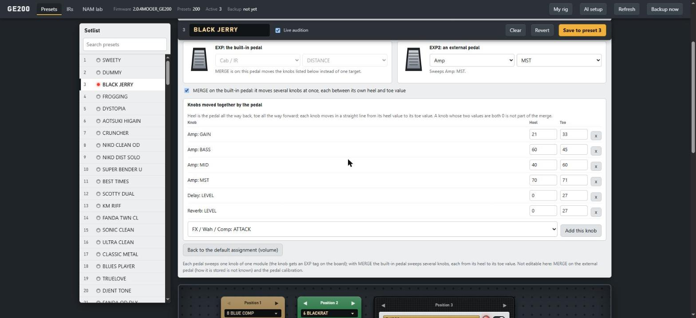

# Usage and features

The short version is in the [README](../README.md); the byte-level details are in [PROTOCOL.md](../PROTOCOL.md).
This page covers every feature. Reading is the default everywhere; anything that changes the unit is opt-in and is
called out below.

## Command line
Reading only sends the vendor editor's own hello (`CMD 0xE0`); the unit answers with its full state (200 presets, the active
preset, the firmware string). Everything that changes the unit needs `--write` (CLI) or `allow_write=True` (library).
**Writing changes persistent preset memory: take a `dump` first.**
```
python -m ge200 devices                    # list the HID interface (no I/O)
python -m ge200 info                       # firmware string, number of presets, active preset
python -m ge200 list
python -m ge200 show 162
python -m ge200 dump presets.json --raw dump.bin
python -m ge200 diff before.json after.json   # which preset bytes differ between two dumps (offline)
python -m ge200 --from-raw dump.bin list   # work offline on a saved raw dump
python -m ge200 select 12 --write          # make preset 12 active
python -m ge200 write-slot 199 presets.json --write   # store the preset with index 199 from a dump into slot 199
```
## Web editor
```powershell
python -m ge200.web --backup-dir C:\path\to\backups [--names model_names.json] [--port 8200]
python -m ge200.web --backup-dir ... --demo-raw dump.bin     # try the UI on a saved dump, no device
```
Open http://127.0.0.1:8200/. Pick a preset (this selects it on the device), edit the name, chain order and each
module (on/off, model, parameters). With "live audition" on, edits go to the device's working copy only
(about 0.35 s after you stop moving a slider); **Save** stores the preset in its slot, verifies it by reading
it back, and writes a full JSON backup first (once per session). **Revert** reloads the stored preset.
Reading the whole device takes about 16 s (the device streams 12 presets per second), so startup and
**Refresh** take that long; a save returns in about a second and is not re-read automatically (press Refresh to
verify). While a read is running, writes wait for it to finish: writing during the stream can wedge the device's
input parser (see PROTOCOL.md).
The server only listens on 127.0.0.1, checks the Host header and requires a per-run token for every change.
Sliders carry the device's own knob names for the selected model (taken from the unit's firmware); an italic name
ending in `?` is a guess (hover for the confidence). Delay time and the custom EQ frequencies are editable too.

## Tone generator (optional, any LLM provider)
In the web editor, type a description ("dreamy clean with a long shimmery reverb") and press **Generate**.
The model gets your description, the current preset, the device's own knob labels and a stable sample of your own
presets, and answers with a preset edit as JSON. The edit is validated and **clamped to the ranges your own
presets use**, loaded into the editor, and *not* sent to the device until you press **Audition now** (turn your
volume down first: levels are unverified) or move a control; nothing is stored until you press Save.

Press **AI setup** in the editor's top bar, paste a key for any one provider and pick it next to the Generate button.
Keys are stored in `llm.json` next to your rig file (outside the repository, plain text like a `.env`), never shown
again and only sent to that provider. Or configure it in `.env` (see `.env.example`) or the environment. Providers
(`ge200/llm.py`):

| id | service | credentials |
|---|---|---|
| `anthropic` | Claude (uses the SDK if installed, plain REST otherwise) | `ANTHROPIC_API_KEY` |
| `openai` | OpenAI Chat Completions | `OPENAI_API_KEY` |
| `gemini` | Google Gemini | `GEMINI_API_KEY` or `GOOGLE_API_KEY` |
| `openrouter` | OpenRouter (many vendors) | `OPENROUTER_API_KEY` |
| `local` | any OpenAI-compatible server you run (Ollama, LM Studio, vLLM, llama.cpp) | `GE200_LLM_BASE_URL` |

`GE200_LLM_PROVIDER` / `GE200_LLM_MODEL` set the defaults. Model names are not guessed for the non-Claude providers:
name one in the environment or in the editor (it remembers it). The OpenAI-style and Gemini providers need no extra
packages. Adding another back end is one small class in `ge200/llm.py`.

Safety: hosted providers always talk to their fixed vendor URL, so a key can never be sent somewhere else; the only
user-chosen address is your own `local` server. The page can choose a provider *id* and a model *name* per request,
never a URL.
**Verified vs not:** only the Claude provider has been run against the real service. The others are tested against a
local fake HTTP server and follow the vendors' documented request shapes; a real service may reject something small.
Please report what it says.

Privacy: the description, the base preset, about a dozen of your presets (names and settings), your rig text and, if
you pass `--names`, the model-name tables are sent to the provider you choose. Use `local` to keep it on your machine.
Each hosted request costs a few cents; the Claude provider marks the stable part of the prompt (~3k tokens) for caching.

### My rig
**My rig** (header) stores your guitar, pickups, listening setup and taste in `%APPDATA%\ge200\rig.json` (outside the
repo; override with `GE200_RIG`). It is added to the tone generator's prompt so tones fit *your* setup. Parameter
meanings with confidence levels live in `ge200/params.py` (sliders show the label, an italic `?` marks guesses).

## Expression pedals

<p align="center"></p>

Each preset assigns the built-in pedal (EXP) and the external one (EXP2) to one knob of one module, or lets the built-in
pedal **MERGE**: move several knobs at once, each between its own heel and toe value. The editor shows both in the
**Expression pedals** panel (module and knob menus with a note when the module is off or the current model has no such
knob; for MERGE a list of knobs with heel and toe values and an "add this knob" menu) and tags the affected knobs on the
board. How it is stored was worked out by comparing the unit's state frames with stored presets, reading the firmware's
MERGE code and checking everything on 200 real presets (PROTOCOL.md). Not editable yet: MERGE on the external pedal (where
it is stored is unknown) and the pedal calibration.

## Your own impulse responses (IRs)
The unit has 10 places for your own cabinet IRs (they appear as *IR slot 1 to 10* in a Cab module). The editor's **IRs**
tab takes a WAV/FLAC/AIFF file (drop it, choose it, or pick one from the `--ir-dir` folder), shows what will be sent
(512 samples at 44.1 kHz, the end faded out), lets you name it and pick a slot, and uploads it. The IR that was in the
slot is replaced and the unit cannot give it back; the page sends the name it showed for that slot, so a stale page
can never overwrite a different IR. Needs numpy, scipy and soundfile (`pip install .[audio]`). Command line:
`python -m ge200 ir-upload SLOT file.wav --name NAME --write`.

## NAM lab (second engine)
NAM (Neural Amp Modeler) captures run in a **separate environment** (`.venv-nam`: PyTorch + neural-amp-modeler), so the
main environment stays light. Start the editor with your folders and use the **NAM lab** tab to render a DI recording
through a capture and an optional cabinet IR:
```powershell
python -m ge200.web --backup-dir ... --nam-dir D:\nam --ir-dir D:\ir --di-dir D:\di
python -m ge200.nam inspect model.nam          # metadata
python -m ge200.nam render model.nam di.wav out.wav --ir cab.wav
python -m ge200.nam bench model.nam            # speed on this machine
```
A standard-size WaveNet renders about 10x faster than real time on a laptop CPU. Live playing through Python is
**not** practical (block processing took 9-13 ms per 2.7 ms block); use a native NAM host for that. NAM models cannot be
loaded into the GE200 itself (its amp slots take Mooer's own capture format).

## Without the PC (idea, partly implemented)
The unit has no WiFi or Bluetooth, but anything that can act as a USB host can sit next to it and serve the web
editor over its own WiFi. `ge200/hid_linux.py` is a hidraw transport (Raspberry Pi etc.): it is written and tested with
fake I/O only and has **not** been tried on a real Linux machine yet. NAM captures cannot run on the GE200 itself (its
amp slots take Mooer's own `.amp/.GNR` format); a small computer could run NAM next to it.

## Model names
Model names (amp/cab/effect names) are vendor data and are not shipped. If you own the official editor you
can build a local table with `tools/extract_names.py` (it looks for a few anchor strings in your own installed editor)
and pass it with `--names`. Type numbers are
1-based table positions; that mapping is inferred, not verified on every module.

Dumps contain your own presets: keep them out of public repositories.

## Tests
```
python -m unittest discover -s tests -t .
```
Tests use synthetic data only.

## Provenance
The device, the goals, the hardware tests and the decisions are the owner's. The protocol analysis
(static analysis of the vendor editor, USB captures) and all the code in this repository were written by
Claude Code (Anthropic) under the owner's direction.
